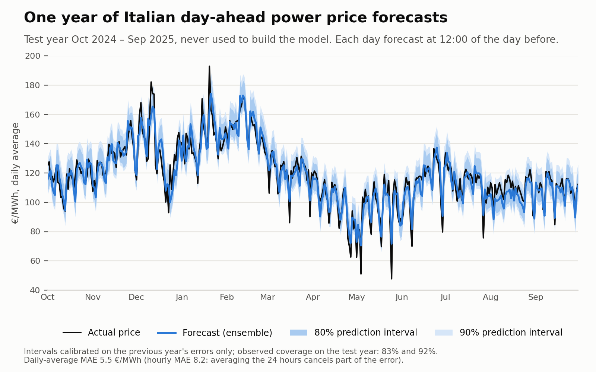
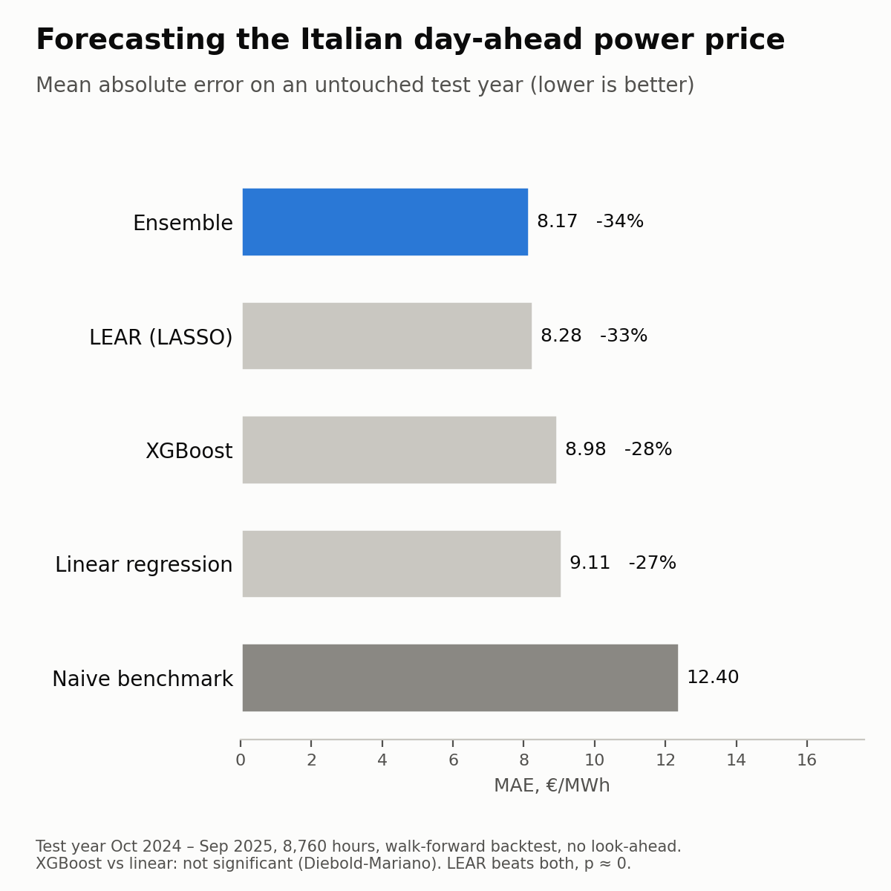
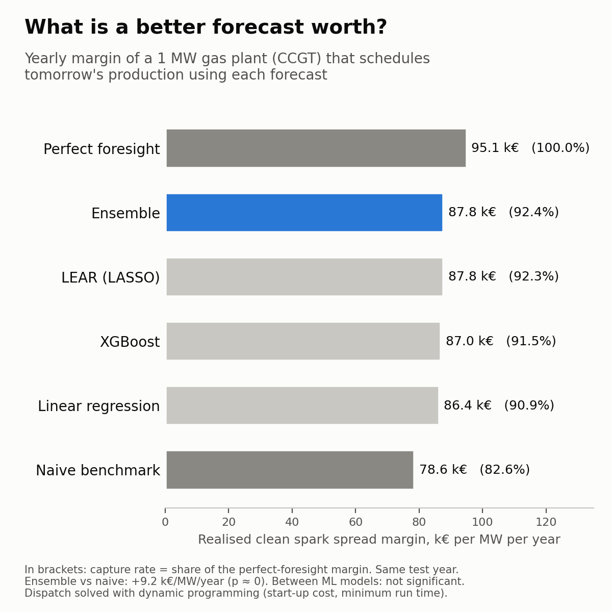

# Day-ahead Italian power price forecasting & CCGT dispatch

Forecasting the **Italian day-ahead electricity price (PUN)** hour by hour, and measuring
what those forecasts are worth in euros to a **gas-fired power plant (CCGT)** deciding when
to run.

Perimeter: **1 Jan 2021 → 30 Sep 2025, hourly** (41,615 hours) — gas crisis included.
Author: Andrea Gatti.

---

## TL;DR



**1. Forecasting** — four models, chosen on a validation year and scored **once** on an
untouched test year (Oct 2024 → Sep 2025), with walk-forward backtesting and no look-ahead.

| Model | MAE €/MWh | RMSE €/MWh | rMAE vs naive |
|---|---|---|---|
| Naive benchmark (`naive_epf`) | 12.41 | 19.12 | 1.000 |
| Hourly linear regression | 9.11 | 13.02 | 0.734 |
| XGBoost | 8.98 ± 0.03 | 12.97 | 0.724 |
| LEAR (LASSO, Lago et al. 2021) | 8.28 | 12.17 | 0.667 |
| **Equal-weight ensemble** | **8.17 ± 0.01** | **11.84** | **0.659** |

- Every model beats the naive benchmark (Diebold-Mariano, p ≈ 0): **−34% MAE** for the ensemble.
- **XGBoost does not beat an hourly linear regression in any detectable way** on the test year.
- **LEAR beats both** (p ≈ 0). The ensemble has the lowest MAE, but its edge over LEAR is
  not statistically significant.
- The ranking chosen on validation was *not* the one confirmed on test: data snooping showed
  up as ranking instability, not as worse errors.



**2. Spark spread & dispatch** — a hypothetical 1 MW CCGT (55% efficiency) decides every
day at 12:00 which hours to run tomorrow, using each forecast, with start-up costs and a
minimum run time (solved exactly with dynamic programming).

| Forecast used | Capture rate | Margin k€/MW/year |
|---|---|---|
| Perfect foresight | 100% | 95.1 |
| Ensemble · LEAR | 92.4% · 92.3% | 87.8 · 87.8 |
| XGBoost · Linear | 91.5% · 90.9% | 87.0 · 86.4 |
| Naive | 82.6% | 78.6 |

- A good forecast is worth **≈ +9 k€ per MW per year** over the naive one.
- Between ML models the economic differences (≤ 1.4 k€) sit **below what one year of data
  can detect** (≈ 2.2 k€, Newey-West HAC test): a model that is significantly more accurate
  is not necessarily significantly more profitable.



---

## Why this problem

The hourly price is set by the **marginal unit** — in Italy almost always a gas CCGT. So it
depends on **residual load** (load forecast − wind − solar forecast) and on the cost of
covering it (gas + CO₂). The merit order is non-linear and its slope scales with fuel
cost: a single *gas × residual load* interaction cut the linear model's error by 14%,
more than XGBoost added on top.

## Data

| Source | What | Role |
|---|---|---|
| GME — MGP | Hourly national (PUN) and zonal prices | Target, lagged prices |
| GME — MGP-GAS | Daily gas price | Feature, spark spread |
| ENTSO-E Transparency Platform | Load, wind and solar — forecast and actual | Features (forecasts only), diagnostics |
| EEX primary auctions | EUA (CO₂) price | Clean spark spread |
| `holidays` | Italian public holidays | Calendar features |

**Anti-leakage rule:** a variable is a valid feature only if its value was known at
**12:00 of D-1** (MGP gate closure). Actual values are never model inputs.

**Why the perimeter stops at 30 Sep 2025:** on 1 Oct 2025 the Italian day-ahead market
moved to **15-minute** products. Mixing resolutions would need a separate treatment.

## Method

- **Split** (thermal years, Oct → Sep): train Jan 2021 → Sep 2023 · validation
  Oct 2023 → Sep 2024 (every modelling choice made here) · test Oct 2024 → Sep 2025
  (opened once).
- **Walk-forward backtest** with a leakage guard: for each day D, the model is trained only
  on data before D.
- **Metrics:** MAE, RMSE, WAPE and rMAE against a naive benchmark. MAPE is excluded
  (zero-price hours) and so is R².
- **Significance:** multivariate Diebold-Mariano test on daily losses; every change to a
  model is kept only if significant *and* physically sensible.
- **Stochastic models** reported as mean ± std over 5 seeds.

## Repository structure

```
pun-forecast/
├── notebooks/
│   ├── 01_ingestion.ipynb       GME MGP prices -> hourly parquet (DST-safe)
│   ├── 02_eda.ipynb             seasonality, zero-price hours, market splitting
│   ├── 03_entsoe_ingestion.ipynb  ENTSO-E load / wind / solar via API
│   ├── 04_gas_ingestion.ipynb   GME daily gas prices
│   ├── 05_dataset.ipynb         one hourly modelling table, leakage rules applied
│   ├── 06_baseline.ipynb        naive forecasts + evaluation framework
│   ├── 07_linear.ipynb          24 hourly linear regressions
│   ├── 08_xgboost.ipynb         gradient boosting
│   ├── 09_lear.ipynb            LEAR: 24 LASSO models on 246 features
│   ├── 10_final_test.ipynb      the test year, scored once
│   ├── 11_eua_ingestion.ipynb   EUA (CO2) auction prices
│   └── 12_spark_spread.ipynb    clean spark spread + CCGT dispatch (dynamic programming)
├── src/forecasting.py           shared split, metrics, walk-forward, Diebold-Mariano
├── src/make_post_figures.py      the summary figures
├── results/                     metrics, tests, configs and figures
└── data/                        raw + processed (not versioned)
```

## How to reproduce

```bash
conda create -n energia python=3.12
conda activate energia
pip install -r requirements.txt
cp .env.example .env    # add your ENTSO-E API token
```

1. Download the GME yearly files (MGP prices, MGP-GAS) into `data/raw/gme_mgp/` and
   `data/raw/gme_gas/`, and the EEX primary auction reports into `data/raw/eex_eua/`.
2. Run the notebooks in order, from the `notebooks/` folder. Each one reads only files
   written by the previous ones.

## Limitations

- The target is the national **PUN index**; the price actually traded and earned by a
  plant is the **zonal** one (basis risk).
- One test year → limited statistical power, especially for the economic comparison.
- Validation and test both fall in a calm gas regime.
- The plant is hypothetical; the dispatch is myopic (one day ahead) and ignores
  intraday and balancing markets.

## References

- Lago, Marcjasz, De Schutter & Weron (2021), *Forecasting day-ahead electricity prices:
  a review of state-of-the-art algorithms, best practices and an open-access benchmark.*
- Ziel & Weron (2018), *Day-ahead electricity price forecasting with high-dimensional
  structures.*
- Hubicka, Marcjasz & Weron (2019), *A note on averaging day-ahead electricity price
  forecasts across calibration windows.*
